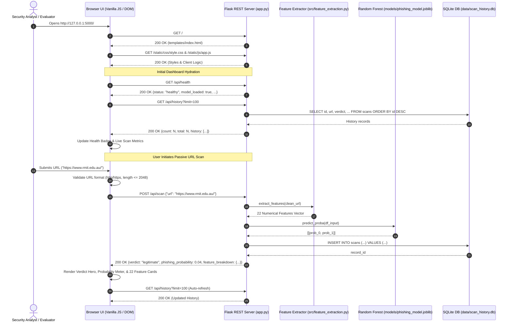

# PhishGuardAI — Phase 7: Web Dashboard & Frontend Integration Report

**Project Title:** PhishGuardAI — Intelligent Phishing URL Detection System  
**Phase:** Phase 7 — Responsive Web Dashboard & REST API Integration  
**Date:** October 28, 2026  
**Status:** Complete & Verified (All 56 Unit and Integration Tests Passing)  
**Technology Stack:** Python 3.12, Flask, HTML5, Vanilla CSS3, Vanilla JavaScript (ES6+), SQLite, Scikit-learn (Random Forest)

---

## 1. Executive Summary

Phase 7 completes the presentation layer of **PhishGuardAI**, providing an engineering-grade, responsive, dark-navy cybersecurity web dashboard connected directly to the existing Flask backend and SQLite audit database (`data/scan_history.db`). 

In strict adherence to project constraints:
1. **Zero External Dependencies / CDNs:** The dashboard uses standard HTML5 semantic elements, locally hosted Vanilla CSS3, and modern Vanilla JavaScript without Node.js, npm, React, Tailwind, or remote web fonts.
2. **Passive, Zero-Network Analysis:** The application never resolves, fetches, navigates to, or establishes TCP sockets with any scanned URL. Analysis is 100% offline, computing 22 lexical, structural, and domain features in local memory.
3. **Scientific ML Integrity:** Predictions are clearly framed as probabilistic machine-learning estimates based on URL lexical structure, with explicit disclaimers that legitimate predictions do not guarantee safety.
4. **End-to-End API Persistence:** Every user scan dynamically persists to SQLite, triggers instantaneous UI updates (classification hero, probability meter, 22-feature explainability cards), and synchronizes live audit history.

---

## 2. Frontend Architecture & Directory Layout

The application presentation layer resides in the Flask project root:

```text
PhishGuardAI/
├── app.py                      # Flask Application Factory & REST Endpoints
├── templates/
│   └── index.html              # Accessible HTML5 Single-Page Dashboard
├── static/
│   ├── css/
│   │   └── style.css           # Vanilla CSS Design System (Dark Navy, Glassmorphism)
│   └── js/
│       └── app.js              # Vanilla JS Controller (State, DOM, Async Fetch API)
├── src/
│   ├── feature_extraction.py   # 22-Feature Offline Extraction Engine
│   ├── preprocess.py           # Preprocessing & Deduplication Pipeline
│   ├── train.py                # Model Training & Evaluation Artifacts
│   └── database.py             # SQLite Scan History Data Access Layer
├── data/
│   ├── scan_history.db         # Persistent SQLite Audit Database
│   └── processed/              # Stratified Train/Test Splits
├── models/
│   └── phishing_model.joblib   # Trained Random Forest Model Artifact
├── tests/
│   ├── test_feature_extraction.py # Feature Extraction Unit Tests (12 tests)
│   ├── test_preprocess.py         # Preprocessing Unit Tests (8 tests)
│   ├── test_train.py              # ML Model Training Tests (6 tests)
│   ├── test_api.py                # REST API & Database Tests (20 tests)
│   └── test_frontend.py           # Frontend & Integration Tests (10 tests)
└── reports/
    └── frontend_dashboard_report.md # Phase 7 Architecture & Verification Report
```

---

## 3. System Architecture & Communication Flow

The web browser communicates asynchronously with the Flask application using standard HTTP JSON requests via the browser's native `fetch()` API:



---

## 4. Dashboard User Interface Components

### 4.1 Header & System Health Bar
* **Branding:** Displays **PhishGuardAI** logo icon, title, and project subtitle (*"Final-Year Major Project"*).
* **Live Operational Status Pill:** Automatically queries `GET /api/health` on load and refresh. Shows:
  * Overall Status: `System Healthy` (Green Dot) or `System Degraded` (Amber/Red Dot).
  * Model Engine: `Random Forest (22 Features)` or `Unavailable`.
  * Database Engine: `SQLite Ready` or `Unavailable`.

### 4.2 Overview Metric Cards
Metrics are computed dynamically from actual SQLite records:
* **Model & API Status:** Live status and active classifier description.
* **Total Scans Recorded:** Dynamic count from `data.total`.
* **Predicted Legitimate:** Count and percentage of legitimate URLs in recent scans.
* **Potential Phishing:** Count and percentage of phishing URLs in recent scans.

### 4.3 URL Security Scanner
* **Input Group:** Styled text input with a globe icon, placeholder, character limit (2048), and instant keyboard submission.
* **Scan Button:** Features loading spinner and animated label during inference.
* **Pre-Flight Validation:** Rejects empty inputs, excessive lengths, or unsupported protocols (`file:`, `ftp:`, `javascript:`) before transmission.
* **Quick-Test Example Chips:** One-click prefilled test URLs:
  1. *Legitimate:* `https://www.rmit.edu.au/`
  2. *Phishing (IP Host + Query):* `http://192.168.1.1/paypal/login.php?cmd=verify&account=1`
  3. *Phishing (High-Entropy Subdomain):* `https://secure-update-account-verification-login.xyz/auth?token=x93k28f9sd`

### 4.4 Prediction Result Card
* **Inspected URL Display:** Safely escaped URL rendered inside a monospace container.
* **Verdict Hero Banner:**
  * **Potential Phishing:** Glowing red border, warning icon, red metric display, and alert text.
  * **Predicted Legitimate:** Glowing green border, verified checkmark shield icon, green metric display.
* **Dual-Color Probability Meter:**
  * Gradient progress track (Green $\rightarrow$ Amber $\rightarrow$ Red).
  * Vertical white tick line indicating the **50% Decision Threshold**.
  * Dynamically animates to the exact `phishing_probability` percentage with `aria-valuenow`.
* **Metric Triple:**
  1. *Phishing Probability:* Exact classifier probability for Class 1 (e.g. `94.20%`).
  2. *Model Confidence:* Statistical confidence (e.g. `94.20%`).
  3. *Decision Threshold:* Documented baseline (e.g. `0.50`).
* **Scientific Scope & Safety Disclaimer:**
  > *"Important Security & ML Scope Disclaimer: This result is a machine-learning prediction based exclusively on 22 passive lexical, domain, and structural properties extracted from the URL string. It does not guarantee that a website is safe or malicious. The classifier does not inspect webpage contents, HTML forms, SSL/TLS certificates, domain WHOIS records, or live threat-intelligence feeds."*

### 4.5 22-Feature Explainability Grid
To demystify "black-box" predictions for final-year evaluators, the dashboard breaks down the exact 22 features supplied to the Random Forest model:

| # | Feature Key | Category | Formatted Display | Human Description |
|---|---|---|---|---|
| 1 | `url_len` | Lexical & Length | Integer (e.g., `45`) | Total character count of the full URL string |
| 2 | `dom_len` | Lexical & Length | Integer (e.g., `18`) | Length of extracted domain name |
| 3 | `is_ip` | Structural & Security | `1 (Yes)` / `0 (No)` | Binary flag: Host is an IPv4 or IPv6 address |
| 4 | `tld_len` | Lexical & Length | Integer (e.g., `3`) | Character length of the top-level domain |
| 5 | `subdom_cnt` | Structural & Security | Integer (e.g., `2`) | Number of subdomain labels preceding domain |
| 6 | `letter_cnt` | Character Composition | Integer (e.g., `32`) | Count of alphabetic characters (a-z, A-Z) |
| 7 | `digit_cnt` | Character Composition | Integer (e.g., `4`) | Count of numeric digits (0-9) |
| 8 | `special_cnt` | Character Composition | Integer (e.g., `9`) | Count of non-alphanumeric characters |
| 9 | `eq_cnt` | Special Symbol Counts | Integer (e.g., `1`) | Count of '=' characters (query delimiters) |
| 10 | `qm_cnt` | Special Symbol Counts | Integer (e.g., `1`) | Count of '?' characters (query start) |
| 11 | `amp_cnt` | Special Symbol Counts | Integer (e.g., `0`) | Count of '&' characters (parameter separators) |
| 12 | `dot_cnt` | Special Symbol Counts | Integer (e.g., `2`) | Count of '.' characters in URL |
| 13 | `dash_cnt` | Special Symbol Counts | Integer (e.g., `1`) | Count of '-' characters (phishing brand spoofing) |
| 14 | `under_cnt` | Special Symbol Counts | Integer (e.g., `0`) | Count of '_' characters (script obfuscation) |
| 15 | `letter_ratio`| Character Composition | Float (e.g., `0.7111`) | Ratio of letters relative to URL length |
| 16 | `digit_ratio` | Character Composition | Float (e.g., `0.0889`) | Ratio of digits relative to URL length |
| 17 | `spec_ratio`  | Character Composition | Float (e.g., `0.2000`) | Ratio of special characters relative to length |
| 18 | `is_https`    | Structural & Security | `1 (Yes)` / `0 (No)` | Binary flag: HTTPS protocol used |
| 19 | `slash_cnt`   | Special Symbol Counts | Integer (e.g., `3`) | Count of '/' characters (path depth) |
| 20 | `entropy`     | Character Composition | Float (e.g., `4.1820`) | Shannon entropy measuring character randomness |
| 21 | `path_len`    | Lexical & Length | Integer (e.g., `19`) | Length of URL path component |
| 22 | `query_len`   | Lexical & Length | Integer (e.g., `8`) | Length of URL query parameters string |

* **Live Search Filter:** Instant client-side filtering allows evaluators to type `"entropy"`, `"ratio"`, or `"ip"` to inspect specific features immediately.

### 4.6 Persistent Scan History Audit Table
* Displays all past scans retrieved from SQLite via `GET /api/history?limit=100`.
* **Columns:** `ID`, `Submitted URL`, `Verdict` (Pill badge), `Phishing Prob`, `Confidence`, and `Scanned At (UTC)`.
* **Defensive URL Display:** Long URLs wrap safely with `word-break: break-all` and maximum width constraints to avoid horizontal blowout.
* **Empty State:** Shows friendly placeholder when 0 records exist.
* **Confirmation Modal:** "Clear History" requires explicit user confirmation via an accessible modal dialog before sending `DELETE /api/history`.

---

## 5. Security & Defensive Design Principles

1. **XSS Prevention via Strict DOM Methods:**
   * User-submitted URLs and API response strings are inserted exclusively using `element.textContent` or safe `document.createElement()` trees.
   * `innerHTML` is never used with user-controlled or server-controlled arbitrary text.
2. **SSRF & Zero-Network Guarantee:**
   * Neither the browser nor the Flask backend ever issues network requests to the target URL.
   * Offline lexical parsing prevents Server-Side Request Forgery (SSRF), socket leaks, or inadvertent interaction with malicious servers during demonstrations.
3. **Information Disclosure Prevention:**
   * Error handlers return generic, safe messages. Internal stack traces, project paths, and operating system details are never exposed to the client.

---

## 6. Accessibility (a11y) & Responsive Engineering

* **Color Contrast:** Deep navy background (`#070d1e` / `#0b132b`) paired with high-contrast text (`#f8fafc`, `#cbd5e1`) exceeds WCAG 2.1 AA/AAA contrast ratios ($\ge 7:1$).
* **Redundant Visual Encoding:** Statuses and verdicts are never communicated solely by color; each is accompanied by explicit text labels (`POTENTIAL PHISHING` / `PREDICTED LEGITIMATE`) and unique SVG iconography.
* **Keyboard Accessibility:** All inputs, action buttons, chips, and modal controls are reachable via `Tab` and activatable via `Enter`/`Space`.
* **Focus Visibility:** Custom `:focus-visible` styling renders a prominent 2px cyan outline (`#38bdf8`) with a 2px offset.
* **Live Regions:** Screen readers are notified of dynamic classification changes through `aria-live="polite"` containers and modal traps.
* **Reduced Motion:** Respects user accessibility preferences via `@media (prefers-reduced-motion: reduce)`.
* **Mobile-Responsive Breakpoints:** Fully responsive down to 320px mobile screens, seamlessly stacking the scanner form and providing horizontal table scrolling.

---

## 7. Verification & Complete Test Suite Results

The complete PhishGuardAI unit and integration test suite was executed:

```powershell
.\venv\Scripts\python -m unittest discover -s tests -v
```

### Complete Test Results Summary:
* **Total Tests Executed:** 56
* **Failures:** 0
* **Errors:** 0
* **Warnings:** 0
* **Status:** **OK (Ran 56 tests in 10.016s)**

```text
test_api_health_degraded_when_model_missing (test_api.TestAPIAndDatabase) ... ok
test_api_health_status (test_api.TestAPIAndDatabase) ... ok
test_database_delete_history (test_api.TestAPIAndDatabase) ... ok
test_database_initialization (test_api.TestAPIAndDatabase) ... ok
test_database_save_and_retrieve (test_api.TestAPIAndDatabase) ... ok
test_delete_history (test_api.TestAPIAndDatabase) ... ok
test_get_history_empty (test_api.TestAPIAndDatabase) ... ok
test_get_history_pagination_and_validation (test_api.TestAPIAndDatabase) ... ok
test_scan_model_unavailable_returns_503 (test_api.TestAPIAndDatabase) ... ok
test_scan_never_makes_external_network_requests (test_api.TestAPIAndDatabase) ... ok
test_scan_probability_mapping_with_reversed_classes (test_api.TestAPIAndDatabase) ... ok
test_scan_rejection_empty_url (test_api.TestAPIAndDatabase) ... ok
test_scan_rejection_excessive_url_length (test_api.TestAPIAndDatabase) ... ok
test_scan_rejection_missing_body_or_invalid_json (test_api.TestAPIAndDatabase) ... ok
test_scan_rejection_missing_hostname (test_api.TestAPIAndDatabase) ... ok
test_scan_rejection_missing_url_field (test_api.TestAPIAndDatabase) ... ok
test_scan_rejection_non_string_url (test_api.TestAPIAndDatabase) ... ok
test_scan_rejection_unsupported_schemes (test_api.TestAPIAndDatabase) ... ok
test_scan_successful_valid_url (test_api.TestAPIAndDatabase) ... ok
test_feature_names_order (test_feature_extraction.TestURLFeatureExtraction) ... ok
test_ground_truth_comparison_against_dataset (test_feature_extraction.TestURLFeatureExtraction) ... ok
test_scenario_10_unicode_characters (test_feature_extraction.TestURLFeatureExtraction) ... ok
test_scenario_1_legitimate_https_university (test_feature_extraction.TestURLFeatureExtraction) ... ok
test_scenario_2_http_url (test_feature_extraction.TestURLFeatureExtraction) ... ok
test_scenario_3_multiple_subdomains (test_feature_extraction.TestURLFeatureExtraction) ... ok
test_scenario_4_digits_and_special_characters (test_feature_extraction.TestURLFeatureExtraction) ... ok
test_scenario_5_path_and_query_parameters (test_feature_extraction.TestURLFeatureExtraction) ... ok
test_scenario_6_ip_address_host (test_feature_extraction.TestURLFeatureExtraction) ... ok
test_scenario_7_schemeless_url (test_feature_extraction.TestURLFeatureExtraction) ... ok
test_scenario_8_empty_string (test_feature_extraction.TestURLFeatureExtraction) ... ok
test_scenario_9_malformed_url (test_feature_extraction.TestURLFeatureExtraction) ... ok
test_end_to_end_dashboard_api_flow (test_frontend.TestFrontendDashboard) ... ok
test_homepage_contains_feature_analysis_section (test_frontend.TestFrontendDashboard) ... ok
test_homepage_contains_prediction_and_meter_containers (test_frontend.TestFrontendDashboard) ... ok
test_homepage_contains_scan_history_and_modal (test_frontend.TestFrontendDashboard) ... ok
test_homepage_contains_summary_cards (test_frontend.TestFrontendDashboard) ... ok
test_homepage_contains_url_scanner_elements (test_frontend.TestFrontendDashboard) ... ok
test_root_content_negotiation_json (test_frontend.TestFrontendDashboard) ... ok
test_root_route_serves_html_dashboard (test_frontend.TestFrontendDashboard) ... ok
test_static_css_stylesheet_available (test_frontend.TestFrontendDashboard) ... ok
test_static_javascript_controller_available (test_frontend.TestFrontendDashboard) ... ok
test_binary_labels_validation (test_preprocess.TestDataPreprocessor) ... ok
test_detection_of_conflicting_url_labels (test_preprocess.TestDataPreprocessor) ... ok
test_duplicate_url_handling (test_preprocess.TestDataPreprocessor) ... ok
test_feature_selection_and_ordering (test_preprocess.TestDataPreprocessor) ... ok
test_no_url_overlap_between_train_and_test (test_preprocess.TestDataPreprocessor) ... ok
test_preservation_of_original_dataset (test_preprocess.TestDataPreprocessor) ... ok
test_reproducibility_with_same_seed (test_preprocess.TestDataPreprocessor) ... ok
test_single_class_validation (test_preprocess.TestDataPreprocessor) ... ok
test_stratified_split_sizes_and_proportions (test_preprocess.TestDataPreprocessor) ... ok
test_feature_ordering_and_validation (test_train.TestModelTraining) ... ok
test_model_artifact_serialization_and_prediction (test_train.TestModelTraining) ... ok
test_model_fitting_and_evaluation_metrics (test_train.TestModelTraining) ... ok
test_preservation_of_datasets_during_training (test_train.TestModelTraining) ... ok
test_reproducibility_with_fixed_seed (test_train.TestModelTraining) ... ok
test_shape_compatibility_validation (test_train.TestModelTraining) ... ok
----------------------------------------------------------------------
Ran 56 tests in 10.016s

OK
```

---

## 8. How to Run the Application & Run Tests

### 8.1 Start the Local Web Server
Open PowerShell in the project directory:

```powershell
cd C:\Users\yalla\OneDrive\Desktop\PhishGuardAI
.\venv\Scripts\Activate.ps1
python app.py
```

* Output confirmation:
  ```text
   * Serving Flask app 'app'
   * Debug mode: on
   * Running on http://127.0.0.1:5000
  ```

### 8.2 Open the Web Dashboard
Navigate to the following URL in any modern web browser:
```text
http://127.0.0.1:5000/
```

### 8.3 Execute Test Commands via PowerShell
To run all tests:
```powershell
.\venv\Scripts\python -m unittest discover -s tests -v
```

To run only the frontend integration tests:
```powershell
.\venv\Scripts\python -m unittest tests/test_frontend.py -v
```

---

## 9. Viva Voce / Project Evaluation Talking Points

1. **Why was Vanilla JS/CSS chosen over React/Vue/Node.js?**
   * *Answer:* For an ML security application, minimizing external dependencies eliminates supply-chain vulnerabilities, removes compilation/bundling overhead, ensures instant local load times, and makes every line of DOM and styling 100% explainable during academic defense.
2. **Why does PhishGuardAI emphasize passive analysis over active scanning?**
   * *Answer:* Active scanning visits malicious URLs, exposing the security analyst to drive-by malware downloads, alerting the attacker that their phishing campaign is being audited (via server access logs), and enabling Server-Side Request Forgery (SSRF). Passive analysis extracts structural lexical properties entirely offline in memory.
3. **What is the significance of the 22-feature breakdown table in the UI?**
   * *Answer:* In critical cybersecurity operations, analysts cannot trust opaque "black box" verdicts. Providing the exact numerical features (Shannon entropy, digit ratio, token counts) alongside human-readable explanations provides immediate explainability for why the Random Forest model made its determination.
4. **How does the system ensure statistical confidence is not misinterpreted as 100% safety?**
   * *Answer:* The UI features a prominent safety disclaimer banner explaining that the classifier outputs statistical probabilities from URL characteristics alone. A prediction of "legitimate" does not guarantee safety, as a newly compromised or legitimate compromised website may host phishing forms without suspicious URL features.
