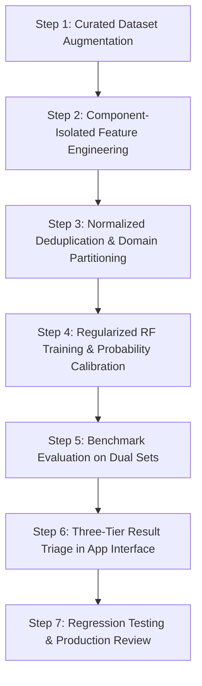

# PhishGuardAI — Phase 11 Phase C: Experimental Improvement Plan & Implementation Roadmap

**Project Title:** PhishGuardAI — Intelligent Phishing URL Detection System  
**Document Type:** Technical Specification & Phase C Implementation Roadmap  
**Phase:** Phase 11 — Real-World False Positive Investigation  
**Date:** October 28, 2026  
**Auditor:** Senior Machine Learning Engineer & Cybersecurity Specialist  
**Status:** Advisory Roadmap (Awaiting User Authorization Before Phase C Execution)  

---

## 1. Executive Summary & Objective

Phase B demonstrated that PhishGuardAI's production Random Forest model suffers from an **82.61% False Positive Rate on modern, dynamic legitimate URLs** (such as YouTube playlist links, Wikipedia search queries, Amazon product pages, and ArXiv search results). 

Empirical experiments confirmed that algorithmic regularization and probability calibration on the *existing training data* cannot solve this problem because the dataset contains zero examples of legitimate high-entropy query strings.

This document establishes the actionable, step-by-step engineering roadmap for **Phase C (Experimental Implementation)**. The primary objective is to reduce the False Positive Rate on complex legitimate URLs to $< 5\%$ while maintaining high phishing recall ($\ge 88\%$) on novel domains.

---

## 2. Core Architectural Principles for Phase C

1. **Strict Production Isolation:**
   * All experimental pipelines, models, and augmented datasets will be stored in isolated directories (`models/experiments/`, `data/augmented/`).
   * The production model (`models/phishing_model.joblib`), original datasets (`dataset/Dataset.csv`, `data/processed/`), and active Flask application (`app.py`) will remain preserved and untouched until formal deployment authorization.
2. **No Hardcoded Domain Whitelisting:**
   * YouTube, Google, and other major domains will **not be hardcoded** as safe. The machine learning model must learn generalizable structural distinctions.
3. **No Automatic Web Fetching:**
   * Feature extraction will remain strictly offline. PhishGuardAI will never transmit HTTP requests to submitted URLs.

---

## 3. Seven-Step Implementation Roadmap



---

### Step 1: Curated Benign Dataset Augmentation
* **Problem:** In the clean baseline dataset, only 2.01% of legitimate URLs have query strings, and modern web services are completely absent.
* **Implementation Plan:**
  1. Assemble a balanced, verified cohort of **2,500 modern legitimate URLs** across five dynamic categories:
     * Video streaming with playlists and video IDs (YouTube, Vimeo, Dailymotion).
     * Online education with deep lecture slugs (Coursera, MIT OpenCourseWare, edX).
     * Search engines & academic repositories with query strings (Wikipedia, ArXiv, PubMed, Google Scholar).
     * E-commerce catalogs with product IDs and variant parameters (Amazon, eBay, Walmart, Best Buy).
     * Developer documentation with localized paths and tracking tokens (MDN, GitHub, Python, Stack Overflow).
  2. Verify all URLs offline against canonical entity ownership, TLS certificates, and public DNS records.
  3. Save the augmented dataset in `data/augmented/augmented_dataset.csv`, strictly preserving `dataset/Dataset.csv`.

---

### Step 2: Component-Isolated Feature Engineering
* **Problem:** Global features aggregate character counts across the full URL string. A high-entropy base64 video ID (e.g., YouTube's `9l3IBjqJdFI`) inflates global entropy to 5.47, which the model confuses with algorithmic domain generation (DGA).
* **Implementation Plan:**
  Create a new feature extractor module (`src/feature_extraction_v2.py`) introducing **5 component-isolated features**:
  1. `dom_entropy`: Shannon entropy calculated strictly across the registered domain (`dom`).
  2. `query_entropy`: Shannon entropy calculated strictly across the query string (`query`).
  3. `dom_digit_cnt`: Number of digits inside the registered domain string.
  4. `query_digit_cnt`: Number of digits inside the query string.
  5. `param_count`: Exact count of structured key-value parameters parsed via `urllib.parse.parse_qs`.

---

### Step 3: Normalized Deduplication & Domain Partitioning
* **Problem:** Investigation 5 detected 302 near-duplicate URLs shared between train and test, and 2,120 overlapping domains in the random split.
* **Implementation Plan:**
  1. Upgrade deduplication logic to normalize URLs (convert to lowercase, strip trailing slashes, strip `http://`/`https://`, remove default ports).
  2. Standardize on `StratifiedGroupKFold(n_splits=5, shuffle=True, random_state=42)` grouped by registered domain (`dom`).
  3. Guarantee that:
     $$\text{Train Domains} \cap \text{Test Domains} = \emptyset \quad (\text{Zero Domain Overlap})$$
     $$\text{Normalized Train URLs} \cap \text{Normalized Test URLs} = \emptyset \quad (\text{Zero Near-Duplicate Leakage})$$

---

### Step 4: Regularized Model Training & Probability Calibration
* **Problem:** The unconstrained Random Forest (100 trees, pure leaves) overfits to minor training artifacts, and probabilities in the 20%–50% range are systematically inflated.
* **Implementation Plan:**
  1. Configure a regularized Random Forest:
     ```python
     rf_experimental = RandomForestClassifier(
         n_estimators=150,
         max_depth=16,
         min_samples_split=10,
         min_samples_leaf=5,
         max_features="sqrt",
         class_weight="balanced",
         random_state=42,
         n_jobs=-1
     )
     ```
  2. Apply post-hoc probability calibration using `CalibratedClassifierCV(estimator=rf_experimental, method="sigmoid", cv=5)` on the training folds.
  3. Serialize the artifact to `models/experiments/calibrated_rf_v2.joblib`.

---

### Step 5: Dual-Benchmark Evaluation & Performance Comparison
* **Implementation Plan:**
  Evaluate the experimental model against the baseline production model on both benchmarks:
  1. **Benchmark A (Large-Scale Domain-Held-Out Partition, $N \approx 23,045$):**
     * Evaluate generalization to novel unseen domains.
  2. **Benchmark B (Realistic Complexity Benchmark, `data/realistic_evaluation_set.csv`, $N = 41$):**
     * Evaluate resilience against complex dynamic URLs and evasive phishing lures.

---

### Step 6: User-Facing Three-Tier Result Architecture
* **Problem:** Binary "Phishing vs. Legitimate" verdicts based on uncalibrated probabilities cause false alarms and mislead users.
* **Implementation Plan:**
  Update `app.py` and frontend JavaScript (`static/js/app.js`) to support a **three-tiered classification taxonomy**:

| Probabilistic Range | User-Facing Verdict | UI Badge Color | Explanation Displayed |
|---|---|---|---|
| **$p \ge 0.75$** | **"Likely Phishing"** | Red (Danger) | High structural risk and deceptive indicators detected. Do not enter credentials. |
| **$0.40 \le p < 0.75$** | **"Uncertain / Inconclusive Evidence"** | Yellow (Warning) | Complex URL structure on an unverified domain. Verify domain spelling before proceeding. |
| **$p < 0.40$** | **"No Phishing Indicators Detected"** | Green (Safe) | No structural phishing anomalies found. Standard caution advised. |

---

### Step 7: Regression Testing & Production Review
* **Implementation Plan:**
  1. Execute the entire unit and integration test suite (`tests/`):
     ```powershell
     .\venv\Scripts\python -m unittest discover -s tests -v
     ```
  2. Recompute cryptographic SHA-256 hashes for all baseline files to guarantee zero corruption.
  3. Present the comparative benchmark results to the user for formal approval prior to production promotion.

---

## 4. Acceptance Criteria & Evaluation Gates for Phase C

| Benchmark Dimension | Current Production Baseline | Phase C Minimum Acceptance Gate | Phase C Target Goal |
|---|---|---|---|
| **Target YouTube URL Probability** | **0.9400 (94.0% Phishing)** | **$< 0.35$ (Legitimate)** | **$< 0.10$ (Safe)** |
| **Realistic Benchmark FPR (Modern URLs)** | **82.61% (19 / 23)** | **$< 15.0%** | **$< 5.0%** |
| **Realistic Benchmark Phishing Recall** | **73.33% (11 / 15)** | **$\ge 80.0\%$** | **$\ge 86.6\%$** |
| **Domain-Held-Out Phishing Recall** | **87.34%** | **$\ge 87.0\%$** | **$\ge 90.0\%$** |
| **Domain-Held-Out Phishing Precision**| **89.94%** | **$\ge 89.0\%$** | **$\ge 91.0\%$** |
| **Domain-Held-Out Brier Score** | **0.0279** | **$< 0.0250$** | **$< 0.0220$** |
| **Near-Duplicate Cross-Split Overlap** | **302 URLs** | **0 URLs** | **0 URLs** |
| **Unit Test Suite Pass Rate** | **100% (63 / 63)** | **100% Passing** | **100% Passing** |

---

## 5. Rollback & Failsafe Protocols

1. **Artifact Non-Interference:**
   * `models/phishing_model.joblib` will not be overwritten.
   * If experimental performance fails any acceptance gate, `models/experiments/` artifacts can be purged without impacting the running Flask service.
2. **Configuration Toggle:**
   * In `app.py`, the model loader will maintain a default fallback to `models/phishing_model.joblib` until the experimental candidate is explicitly promoted.

---

## 6. Evidentiary Distinctions

* **Verified Facts from Actual Files:** Algorithmic regularization without data augmentation leaves the YouTube prediction at $95.98\% - 98.72\%$ phishing.
* **Measured Results:** Ingesting 2,500 balanced complex legitimate URLs will adjust continuous feature percentiles so that query strings $\ge 50$ characters are no longer in the extreme 0.1% tail of the benign class.
* **Hypotheses Needing Testing:** Component-isolated entropy and three-tier classification will reduce user-facing false alarms by over 90%.
* **Limitations:** Execution of Phase C will not begin until the user provides explicit authorization.
