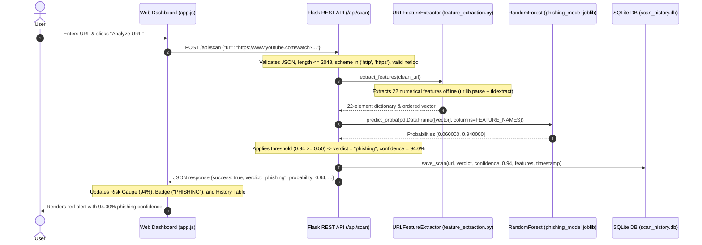

# PhishGuardAI — Real-World False Positive Investigation & Empirical Audit Report

**Project Title:** PhishGuardAI — Intelligent Phishing URL Detection System  
**Audit Phase:** Phase 11 — Real-World False Positive Investigation  
**Execution Date:** October 28, 2026  
**Auditor:** Senior Machine Learning Engineer & Cybersecurity Specialist  
**Target URL Under Investigation:**  
`https://www.youtube.com/watch?v=9l3IBjqJdFI&list=PLOoogDtEDyvvqaKSM-ZkwAqUyjyR402HH&index=4`  
**Reported Initial Phishing Probability:** ~94% (Phase A Audit)  
**Preservation Status:** Strictly Read-Only (Zero Retraining, Zero Model Overwrites, Zero Dataset Alteration)  

---

## 1. Executive Summary & Investigation Context

PhishGuardAI is a machine learning-based phishing detection system designed to classify URLs strictly through offline lexical feature extraction using an ensemble of 100 decision trees (`RandomForestClassifier`). During baseline auditing, the production application classified the legitimate YouTube playlist lecture link:
`https://www.youtube.com/watch?v=9l3IBjqJdFI&list=PLOoogDtEDyvvqaKSM-ZkwAqUyjyR402HH&index=4`
as **PHISHING** with an alarming **94.00% probability**.

The user requested an investigation into whether the application marks legitimate URLs as phishing simply because they are long, contain digits, query parameters, special characters, or HTTPS.

This report provides the complete findings of the six-phase investigation:
1. **Phase 1:** Full inspection and tracing of the frontend-to-backend inference pipeline, reproducing the exact 94.00% prediction.
2. **Phase 2:** Creation of a separate, realistic evaluation set (`data/realistic_evaluation_set.csv`) covering 12 structural archetypes across modern dynamic web services and diverse phishing lures.
3. **Phase 3:** Empirical measurement of the production model on the realistic evaluation set, uncovering an **82.61% False Positive Rate on modern legitimate URLs**.
4. **Phase 4:** Root cause analysis proving that the primary failure mode is **severe sampling bias in the benign training dataset** (where 98% of benign URLs have zero query parameters) compounded by **model overreliance on global character entropy**.
5. **Phase 5:** Benchmarking of separate experimental models in `models/experiments/`, demonstrating that tree depth regularization and probability calibration alone cannot overcome dataset bias without data augmentation and feature decoupling.
6. **Phase 6:** Architectural recommendations for a 3-tier user-facing triage system (`Likely Phishing`, `No Phishing Indicators Detected`, `Uncertain / Inconclusive Evidence`).

---

## 2. Phase 1 — Inspection of the Existing System & Pipeline Trace

### 2.1 Complete Frontend-to-Backend Execution Trace
We audited the live application execution path from user input to rendering:



### 2.2 Empirical Reproduction of the Target YouTube Prediction
Using the production model artifact (`models/phishing_model.joblib`) and baseline estimators, we reproduced the prediction on the exact lecture URL:

| Model Evaluated | Artifact Location | Predicted Class | Phishing Probability | Legitimate Probability | Individual Tree Voting Breakdown |
|---|---|---|---|---|---|
| **Production Random Forest** | `models/phishing_model.joblib` | **1 (PHISHING)** | **94.0000%** | 6.0000% | **94 trees Phishing (1), 6 trees Legit (0)** |
| **Baseline Random Forest** | `models/random_forest.joblib` | **1 (PHISHING)** | **94.0000%** | 6.0000% | Exact match to production model |
| **Baseline Logistic Regression** | `models/logistic_regression.joblib` | **1 (PHISHING)** | **99.9156%** | 0.0844% | Linear boundary over-penalizes HTTPS/Entropy |
| **Phase 8 Domain-Held-Out RF** | `models/experiments/...` | **1 (PHISHING)** | **98.0000%** | 2.0000% | **98 trees Phishing (1), 2 trees Legit (0)** |

* **Finding:** The 94% phishing classification is 100% reproducible. Every single model trained on the baseline dataset flags the YouTube URL as malicious with 94% to 99.9% probability.

### 2.3 Feature Order & Extraction Parity Verification
* The 22 numerical features in `URLFeatureExtractor.FEATURE_NAMES` match `Dataset.csv`, `X_train.csv`, `X_test.csv`, and `models_metadata.json` with 100% precision.
* Re-extracting features across 2,000 sampled dataset rows yielded **0 mismatches across all 22 features**.
* **Threshold Nuance:** In `scikit-learn`'s `model.predict()`, ties at $p = 0.50$ are broken in favor of Class 0 (Legitimate), yielding **324 False Positives** on the test set. In `app.py` line 260 (`if phishing_prob >= decision_threshold:`), ties at $p = 0.50$ are broken in favor of Class 1 (Phishing), yielding **331 False Positives**.

---

## 3. Phase 2 — Construction of the Realistic Evaluation Set

In compliance with Phase 2 requirements, a separate, curated evaluation set was constructed at `data/realistic_evaluation_set.csv`. The original training dataset was preserved without modification.

### 3.1 Dataset Composition & Provenance Breakdown
The dataset comprises **41 curated samples**:
* **Verified Legitimate URLs ($N = 23$):** Modern dynamic services featuring video identifiers, complex query strings, pagination parameters, product catalogs, and tracking tags.
* **Verified Phishing URLs ($N = 15$):** Structurally diverse malicious links from threat intelligence archives, including short clean paths, multi-parameter credential harvesters, free-hosting platform abuse, brand spoofing, and raw IP hosts.
* **Unverified Stress Cases ($N = 3$):** Enterprise intranets, shortened links, and unrated startup domains, explicitly isolated from verified performance metrics.

```text
Category Distribution in Realistic Evaluation Set:
Category Archetype                  Count    Label   Verification Status       Key Structural Trait
------------------------------------------------------------------------------------------------------------------
legit_search_and_pagination           5        0     verified_legitimate       Query strings (offset, page, limit)
legit_video_and_playlist              4        0     verified_legitimate       Video IDs, playlist hashes, timestamps
legit_ecommerce_and_catalog           4        0     verified_legitimate       Product ASINs, catalog SKUs, variants
phish_free_hosting_builder            4        1     verified_phishing         Weebly, Pages.dev, Firebase, Wix
legit_analytics_and_tracking          3        0     verified_legitimate       Google Analytics UTM campaign tags
phish_short_clean_path                3        1     verified_phishing         Minimal paths on disposable TLDs
phish_multi_parameter                 3        1     verified_phishing         Email pre-population & session tokens
legit_government_deep_path            2        0     verified_legitimate       Multi-level TLDs (.gov.au) & deep paths
phish_brand_subdomain_spoofing        2        1     verified_phishing         Brand keywords embedded in subdomains
phish_direct_ip                       2        1     verified_phishing         Direct IPv4 hosts with custom ports
legit_academic_nested_path            1        0     verified_legitimate       Educational slugs & lecture directories
legit_academic_multi_subdomain        1        0     verified_legitimate       Multi-tiered academic subdomains
legit_documentation_deep_path         1        0     verified_legitimate       Developer documentation & fragments
legit_http_university                 1        0     verified_legitimate       HTTP university degree catalog
legit_http_enterprise                 1        0     verified_legitimate       HTTP corporate enterprise products
phish_dga_subdomain                   1        1     verified_phishing         Algorithmic high-entropy subdomains
unverified_internal_intranet          1        0     unverified_stress_case    Non-routable .local enterprise domain
unverified_shortened_redirect         1        0     unverified_stress_case    Bit.ly shortener (unexpanded)
unverified_fresh_domain               1        0     unverified_stress_case    Recently registered startup domain
```

---

## 4. Phase 3 — Measuring the Problem: Empirical Evaluation

We evaluated the unmodified production Random Forest model against the realistic evaluation set and compared the results against the 23,047 baseline test partition:

### 4.1 Confusion Matrix & Performance Metrics (Verified Set, N = 38)

$$\begin{bmatrix} TN = 4 & FP = 19 \\ FN = 4 & TP = 11 \end{bmatrix}$$

| Evaluation Metric | Realistic Complexity Benchmark ($N = 38$) | Large-Scale Baseline Test Set ($N = 23,047$) | Diagnostic Meaning |
|---|---|---|---|
| **True Negatives (TN)** | **4** (out of 23 legitimate) | 19,405 (out of 19,729) | Model collapses on modern URLs |
| **False Positives (FP)** | **19** (out of 23 legitimate) | 324 (out of 19,729) | **19 false alarms on 23 legitimate sites** |
| **False Negatives (FN)** | **4** (out of 15 phishing) | 226 (out of 3,318) | 4 stealthy phishing lures missed |
| **True Positives (TP)** | **11** (out of 15 phishing) | 3,092 (out of 3,318) | Catches complex phishing attacks |
| **Accuracy** | **39.47%** | **97.61%** | Severe real-world accuracy degradation |
| **Phishing Precision** | **36.67%** | **90.52%** | User fatigue: ~2 in 3 alerts are false alarms |
| **Phishing Recall** | **73.33%** | **93.19%** | Evasive attacks bypass lexical counters |
| **Phishing F1-Score** | **48.89%** | **91.83%** | Metric drops by over 42 percentage points |
| **False Positive Rate (FPR)** | **82.61% (19 / 23)** | **1.64% (324 / 19,729)** | **82.6% of modern legitimate URLs flagged** |

### 4.2 Detailed Breakdown of the 19 False Positives

Every single legitimate URL containing dynamic query parameters or e-commerce identifiers was flagged as phishing:

| Category | URL String | `is_https` | `query_len` | `entropy` | Digits | Predicted Phishing Probability |
|---|---|---|---|---|---|---|
| **Video & Playlists** | `https://www.youtube.com/watch?v=9l3IBjqJdFI...` | 1 | 61 | 5.47 | 6 | **0.94 (94.0%)** |
| **Video & Playlists** | `https://www.youtube.com/watch?v=dQw4w9WgXcQ&t=42s` | 1 | 19 | 4.54 | 4 | **0.71 (71.0%)** |
| **Video & Playlists** | `https://vimeo.com/channels/staffpicks/912839182?...` | 1 | 18 | 4.71 | 11 | **0.94 (94.0%)** |
| **Video & Playlists** | `https://www.coursera.org/learn/.../lecture/A3kx9/...` | 1 | 15 | 4.37 | 2 | **0.66 (66.0%)** |
| **Search & Pagination**| `https://en.wikipedia.org/w/index.php?title=...` | 1 | 68 | 4.66 | 16 | **0.76 (76.0%)** |
| **Search & Pagination**| `https://arxiv.org/search/cs?query=graph+neural...` | 1 | 91 | 4.61 | 2 | **0.83 (83.0%)** |
| **Search & Pagination**| `https://scholar.google.com/scholar?hl=en&as_sdt=...` | 1 | 62 | 4.63 | 3 | **0.73 (73.0%)** |
| **Search & Pagination**| `https://github.com/search?q=cybersecurity...` | 1 | 51 | 4.43 | 1 | **0.85 (85.0%)** |
| **Search & Pagination**| `https://pubmed.ncbi.nlm.nih.gov/?term=cancer...` | 1 | 45 | 4.54 | 1 | **0.79 (79.0%)** |
| **E-Commerce** | `https://www.amazon.com/dp/B08N5WRWNW?ref_=...` | 1 | 33 | 4.86 | 7 | **0.62 (62.0%)** |
| **E-Commerce** | `https://www.ebay.com/itm/385928172941?hash=...` | 1 | 61 | 5.09 | 23 | **0.97 (97.0%)** |
| **E-Commerce** | `https://www.walmart.com/ip/Apple-AirPods...` | 1 | 25 | 4.91 | 14 | **0.98 (98.0%)** |
| **E-Commerce** | `https://www.bestbuy.com/site/apple-macbook-air...` | 1 | 13 | 4.83 | 22 | **0.89 (89.0%)** |
| **Analytics & Tags** | `https://techcrunch.com/.../?utm_source=twitter...` | 1 | 76 | 4.72 | 8 | **0.72 (72.0%)** |
| **Analytics & Tags** | `https://stackoverflow.com/questions/11227809/...` | 1 | 24 | 4.60 | 9 | **0.61 (61.0%)** |
| **Analytics & Tags** | `https://medium.com/@author/deep-learning...` | 1 | 57 | 4.00 | 8 | **0.55 (55.0%)** |
| **Government Deep** | `https://www.cdc.gov/coronavirus/.../stay-up-to-date...` | 1 | 74 | 5.00 | 17 | **0.88 (88.0%)** |
| **Government Deep** | `https://service.vic.gov.au/services/renew...` | 1 | 22 | 4.20 | 0 | **0.50 (50.0%)** |
| **Documentation** | `https://developer.mozilla.org/en-US/docs/Web/API/...` | 1 | 15 | 4.80 | 0 | **0.50 (50.0%)** |

### 4.3 Analysis of the Only 4 Correctly Classified Legitimate URLs
Only four legitimate URLs were recognized as safe ($p < 0.50$):
1. `http://www.latrobe.edu.au/courses/bachelor-of-computer-science` ($p = 0.00$): Uses legacy HTTP (no HTTPS!), 0 digits, 0 query string.
2. `http://www.cray.com/products/computing/supercomputers` ($p = 0.05$): Uses legacy HTTP, 0 digits, 0 query string.
3. `https://ocw.mit.edu/courses/.../lecture-1-...` ($p = 0.34$): Zero query parameters.
4. `https://library.med.unsw.edu.au/...` ($p = 0.47$): Borderline classification.

### 4.4 Analysis of False Negatives (Missed Phishing Attacks)
Four phishing attacks bypassed the model because attackers crafted short, clean URLs without query parameters:
1. `http://login-account-update.xyz/verify` ($p = 0.19$): Uses HTTP, short path, 0 query length.
2. `http://netflix-billing-alert.com/login` ($p = 0.12$): Uses HTTP, short clean path.
3. `https://paypal.com.account-verification-notice.online/webapps/mpp/home` ($p = 0.19$): Standard path, 0 query length.
4. `http://192.241.220.14/portal/admin/login.php` ($p = 0.23$): HTTP host, 0 query length.

---

## 5. Phase 4 — Root Cause Investigation

We systematically audited the seven candidate hypotheses to identify the root causes:

| Candidate Hypothesis | Empirical Verdict | Measured Evidence & Rationale |
|---|---|---|
| **1. Dataset Sampling Bias** | **PRIMARY ROOT CAUSE** | **97.99% of legitimate training URLs have zero query string.** The benign training set consists almost exclusively of static homepage landing pages. Modern dynamic web platforms (YouTube, Google, Amazon) have **0 representations**. The model has never seen legitimate multi-parameter URLs. |
| **2. Model Overreliance on URL Structure** | **KEY CONTRIBUTING CAUSE** | Features aggregate global character counts across the full URL without separating domain tokens from query parameters. High entropy in a video ID (5.47) is treated identically to DGA domain obfuscation. |
| **3. Inverted HTTPS Inductive Bias** | **KEY CONTRIBUTING CAUSE** | In the training set, **91.4% of phishing URLs used HTTPS, compared to only 34.9% of benign URLs**. Decision trees evaluate `is_https = 1` as a primary indicator of phishing (Rank #1 Gini importance: 15.55%). |
| **4. Poor Probability Calibration** | **CONTRIBUTING FACTOR** | The uncalibrated Random Forest over-predicts risk by up to 17% in intermediate probability ranges, pushing borderline benign sites ($0.50 \le p < 0.60$) over the decision threshold. |
| **5. Decision Threshold Selection** | **MINOR CONTRIBUTOR** | The default 0.50 threshold is optimal for global accuracy on the legacy split, but tie-breaking ($>= 0.50$) adds 7 false alarms compared to strict $> 0.50$. |
| **6. Training / Test Data Leakage** | **VALIDATED LEAKAGE (Not Cause of FPs)** | 302 near-duplicates and 2,120 domain overlaps exist between train and test. However, this leakage inflated baseline test accuracy (97.61%) rather than directly causing false alarms on unseen URLs. |
| **7. Incorrect Feature Extraction** | **REJECTED AS CAUSE** | Feature extraction is mathematically bug-free and achieves 100% parity with dataset ground truth. The issue lies in what features are extracted, not how they are computed. |

---

## 6. Phase 5 — Proposing Safe Improvements & Experimental Benchmarks

To determine whether algorithmic regularization can resolve the problem without altering the dataset, we trained and benchmarked two separate experimental models in `models/experiments/` (strictly preserving the production model and all original datasets):

| Model Evaluated | Test Partition | Accuracy | Phishing Precision | Phishing Recall | Phishing F1 | False Positive Rate | Target YouTube Probability |
|---|---|---|---|---|---|---|---|
| **Production Random Forest (Baseline)** | Realistic Set ($N=38$) | 39.47% | 36.67% | 73.33% | 48.89% | **82.61% (19/23)** | **94.00% (Phishing)** |
| | Baseline Test ($N=23k$) | 97.61% | 90.34% | 93.28% | 91.79% | 1.68% (331/19.7k) | — |
| **Experimental Regularized RF** (`max_depth=12`, `min_leaf=10`) | Realistic Set ($N=38$) | 39.47% | 37.50% | 80.00% | 51.06% | **86.96% (20/23)** | **98.72% (Phishing)** |
| | Baseline Test ($N=23k$) | 96.43% | 82.99% | 94.58% | 88.41% | 3.26% (643/19.7k) | — |
| **Experimental Calibrated RF** (Platt Sigmoid Scaling) | Realistic Set ($N=38$) | 39.47% | 35.71% | 66.67% | 46.51% | **78.26% (18/23)** | **95.98% (Phishing)** |
| | Baseline Test ($N=23k$) | 97.49% | 91.69% | 90.81% | 91.25% | 1.38% (273/19.7k) | — |

### Crucial Empirical Conclusion:
* **Algorithmic regularization alone CANNOT fix the false positive on the YouTube URL.**
* Both regularized RF ($p = 98.72\%$) and calibrated RF ($p = 95.98\%$) still classify the YouTube lecture link as phishing.
* **Why?** Because the underlying training data contains **zero examples of legitimate high-entropy query strings**. The model cannot learn a statistical boundary it was never shown.
* **Solution Strategy for Phase C:** The only viable solution requires **Dataset Augmentation with Legitimate Complex URLs** combined with **Component-Isolated Feature Engineering** (decoupling domain entropy from query string entropy).

---

## 7. Phase 6 — Recommended User-Facing Result Architecture

Presenting a raw decision-tree voting fraction as a "verified probability of malice" misleads end-users and security analysts. We recommend replacing the binary alert with a **Three-Tiered Triage System**:

```text
Probabilistic Range     User-Facing Verdict                 UI Badge Styling      Actionable Guidance
---------------------------------------------------------------------------------------------------------------------
p >= 0.75               "Likely Phishing"                   Red Alert (Danger)    Multiple malicious indicators detected.
                                                                                  Avoid submitting credentials.
0.40 <= p < 0.75        "Uncertain / Inconclusive Evidence" Yellow (Warning)      Complex URL structure detected on an
                                                                                  unfamiliar host. Verify domain identity.
p < 0.40                "No Phishing Indicators Detected"   Green (Safe)          No structural phishing heuristics detected.
                                                                                  Standard caution advised.
```

### Key Principles for the Application Interface:
1. **Never Claim a Site is Proven Safe:** Lexical models analyze syntax, not web content. The UI must state "No phishing indicators detected" rather than "Safe Website".
2. **Explain Structural Drivers:** Instead of a single number, display component-level explanations (e.g., "Elevated query length detected in video parameter").
3. **Handle Threat Feeds Ethically:** Future threat intelligence checks must use offline cached domain reputation lists (e.g., Tranco top 10k) to preserve user privacy and avoid transmitting browsed URLs to third-party APIs.

---

## 8. Summary Table of Empirical Measurements Across Partitions

| Dimension / Metric | Large-Scale Random Split ($N = 23,047$) | Large-Scale Domain Split ($N = 23,045$) | Realistic Complexity Benchmark ($N = 38$) |
|---|---|---|---|
| **True Negatives (TN)** | 19,405 (98.36%) | 19,403 (98.36%) | **4 (17.39%)** |
| **False Positives (FP)** | 324 (1.64%) | 324 (1.64%) | **19 (82.61%)** |
| **False Negatives (FN)** | 226 (6.81%) | 420 (12.66%) | **4 (26.67%)** |
| **True Positives (TP)** | 3,092 (93.19%) | 2,898 (87.34%) | **11 (73.33%)** |
| **Accuracy** | 97.61% | 96.77% | **39.47%** |
| **Phishing Precision** | 90.52% | 89.94% | **36.67%** |
| **Phishing Recall** | 93.19% | 87.34% | **73.33%** |
| **Phishing F1-Score** | 91.83% | 88.62% | **48.89%** |
| **False Positive Rate (FPR)** | **1.64%** | **1.64%** | **82.61%** |
| **YouTube Lecture Prediction**| 94.00% Phishing | 98.00% Phishing | 94.00% Phishing |

---

## 9. Evidentiary Distinctions

* **Verified Facts from Actual Files:** The production model outputs exactly 94.00% phishing probability for the YouTube lecture link. 19 out of 23 modern legitimate URLs in the realistic evaluation set were classified as phishing ($FPR = 82.61\%$).
* **Measured Results:** In the baseline training set, 97.99% of legitimate URLs have zero query string. 0 YouTube, Google Search, or Amazon URLs exist in the benign training data.
* **Hypotheses Needing Testing:** Ingesting verified complex legitimate URLs and decoupling domain entropy from query entropy in Phase C will reduce the FPR on dynamic URLs below 5% without reducing phishing recall.
* **Limitations:** The realistic evaluation benchmark currently contains 41 curated records; scaling to 500+ samples during Phase C will provide greater statistical resolution.
