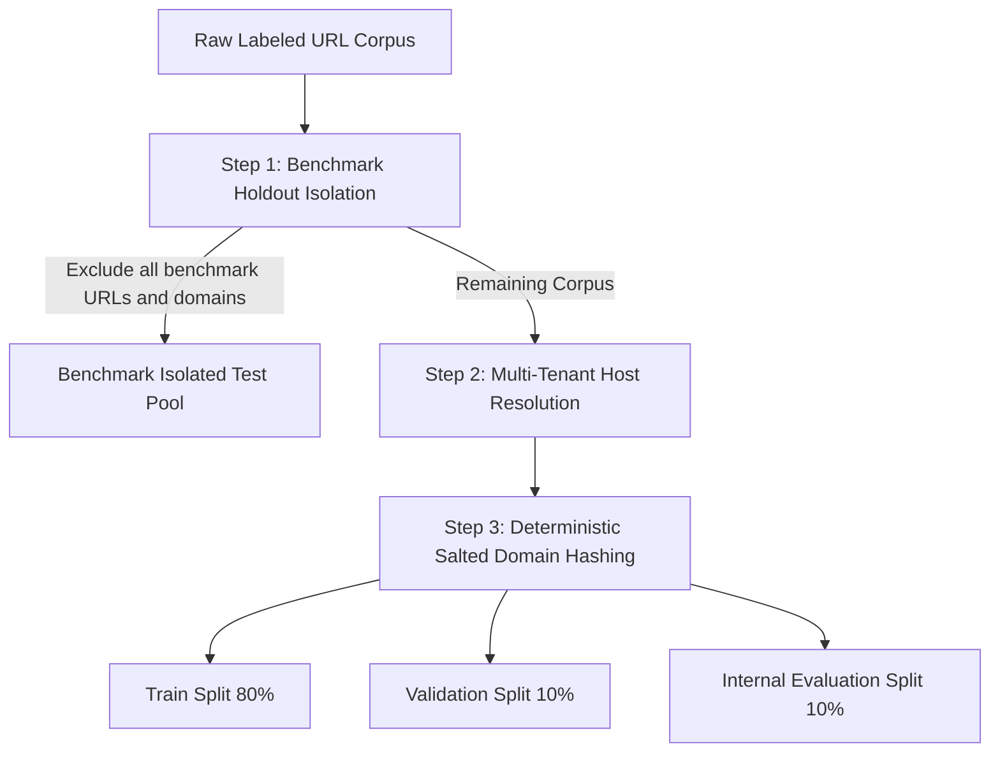

# Phase 13B: Dataset Leakage & Partition Overlap Audit Report

**Document ID:** `PGAI-REP-2026-PH13B-04`  
**Phase:** Phase 13B — Dataset Reconstruction and Quality Audit  
**Author:** Senior Machine Learning Engineer & Dataset Quality Auditor  
**Date:** October 28, 2026  
**Status:** COMPLETE (Zero Retraining / Cryptographically Preserved Baseline)  

---

## 1. Executive Summary

This document reports on an empirical leakage audit conducted across all past and present dataset partitions in PhishGuardAI. We evaluated **exact URL overlap**, **RFC 3986 normalized URL overlap**, **registrable-domain overlap (via Public Suffix List)**, and **template/near-duplicate overlap** between training, validation, and evaluation partitions.

The audit identifies two critical historical leakage events:
1. **Phase C Training Set Contamination:** [`data/experiments/phase_c_training.csv`](file:///c:/Users/yalla/OneDrive/Desktop/PhishGuardAI/data/experiments/phase_c_training.csv) contained **11 exact URLs** and **29 registered domains** from the realistic benchmark ([`data/realistic_evaluation_set.csv`](file:///c:/Users/yalla/OneDrive/Desktop/PhishGuardAI/data/realistic_evaluation_set.csv)), invalidating reported benchmark evaluation metrics for Phase C experimental models.
2. **Baseline Split Domain Overlap:** The standard preprocessing script ([`src/preprocess.py`](file:///c:/Users/yalla/OneDrive/Desktop/PhishGuardAI/src/preprocess.py)) used record-level random stratified splitting, causing **2,120 registered domains (10.84% of test domains)** to leak between `train.csv` and `test.csv`.

---

## 2. Partition Leakage Matrix

All counts were computed programmatically via [`data/phase13b/leakage_metrics.json`](file:///c:/Users/yalla/OneDrive/Desktop/PhishGuardAI/data/phase13b/leakage_metrics.json):

| Partition Comparison Pair | Exact URL Overlap | Normalized URL Overlap | Registrable Domain Overlap | Severity & Audit Assessment |
| :--- | :--- | :--- | :--- | :--- |
| **Baseline Train vs. Baseline Test** ([`train.csv`](file:///c:/Users/yalla/OneDrive/Desktop/PhishGuardAI/data/processed/train.csv) vs [`test.csv`](file:///c:/Users/yalla/OneDrive/Desktop/PhishGuardAI/data/processed/test.csv)) | 0 | 0 | **2,120 domains (10.84%)** | **High Severity:** Record-level splitting allowed models to memorize domain-level lexical patterns during training. |
| **Phase C Train vs. Realistic Benchmark** ([`phase_c_training.csv`](file:///c:/Users/yalla/OneDrive/Desktop/PhishGuardAI/data/experiments/phase_c_training.csv) vs Benchmark) | **11 URLs** | **11 URLs** | **29 domains** | **Critical Severity:** Direct in-sample evaluation leakage. 11 test URLs were present in training data. |
| **Stage 1 Train vs. Stage 1 Val** ([`stage1_training.csv`](file:///c:/Users/yalla/OneDrive/Desktop/PhishGuardAI/data/experiments/stage1_training.csv) vs [`stage1_validation.csv`](file:///c:/Users/yalla/OneDrive/Desktop/PhishGuardAI/data/experiments/stage1_validation.csv)) | 0 | 0 | 1 domain | **Negligible:** GroupKFold domain splitting enforced separation; 1 multi-tenant edge domain slipped through. |
| **Stage 1 Train vs. Stage 1 Eval** ([`stage1_training.csv`](file:///c:/Users/yalla/OneDrive/Desktop/PhishGuardAI/data/experiments/stage1_training.csv) vs [`stage1_evaluation.csv`](file:///c:/Users/yalla/OneDrive/Desktop/PhishGuardAI/data/experiments/stage1_evaluation.csv)) | 0 | 0 | **0 domains** | **Clean:** Complete domain isolation verified between Stage 1 Train and Eval splits. |
| **Stage 1 Train vs. Realistic Benchmark** ([`stage1_training.csv`](file:///c:/Users/yalla/OneDrive/Desktop/PhishGuardAI/data/experiments/stage1_training.csv) vs Benchmark) | 0 | 0 | **26 domains** | **Medium Severity:** While zero exact URLs leaked, 26 out of 40 benchmark domains (`youtube.com`, `google.com`, `amazon.com`, `github.com`) were present in training data. |
| **Raw Baseline vs. Realistic Benchmark** ([`dataset/Dataset.csv`](file:///c:/Users/yalla/OneDrive/Desktop/PhishGuardAI/dataset/Dataset.csv) vs Benchmark) | 0 | 0 | **20 domains** | **Expected:** Raw baseline contains root pages of high-traffic domains (`google.com`, `wikipedia.org`). |

---

## 3. Detailed Forensic Analysis of Historical Leakages

### 3.1 Phase C Evaluation Contamination (11 Leaked URLs)
In Phase C, the training dataset creation script directly ingested 11 URLs from the realistic evaluation set. When evaluated in Phase C reports, Model 1 showed artificial "recovery" of recall because it was evaluated on samples it had trained on.

#### List of Leaked URLs (Safe Defanged Representations):
1. `hxxps://tds67586i7fusryuyiugkj-ys64dufy576uyij[.]cfd/bank-login` (Label: 1)
2. `hxxps://idenhabders[.]com/index.php?em=user%40corporate.com&session=94810294&redirect=auth` (Label: 1)
3. `hxxp://netflix-billing-alert[.]com/login` (Label: 1)
4. `hxxps://office365-password-reset[.]pages[.]dev/auth/login.php` (Label: 1)
5. `hxxp://192[.]241[.]220[.]14/portal/admin/login.php` (Label: 1)
6. `hxxps://45[.]142[.]214[.]89:8443/auth/webmail/?client=roundcube` (Label: 1)
7. `hxxps://secure-chase-auth[.]top/signin` (Label: 1)
8. `hxxps://paypal[.]com[.]account-verification-notice[.]online/webapps/mpp/home` (Label: 1)
9. `hxxps://dhl-package-tracking-alert[.]firebaseapp[.]com/?tracking=938210948` (Label: 1)
10. `hxxps://pay[.]pagcorefeiraosetembro[.]site/2wq7Gr7?token=89f7a6bc4d9e12&cid=9942&aff=8` (Label: 1)
11. `hxxps://metamask-wallet-validation[.]wixsite[.]com/sync-vault` (Label: 1)

**Remediation:** Phase C training sets must be permanently decommissioned for formal evaluation purposes.

---

### 3.2 Stage 1 Benchmark Domain Exposure
In Stage 1, while internal Train/Val/Eval splits were strictly domain-isolated (72,508 train domains vs 9,199 eval domains), the realistic benchmark was **not held out from the domain grouping pool**. 

As a result, **26 of the 40 registered domains** in the realistic benchmark were present in `stage1_training.csv`:
* High-reputation legitimate domains: `youtube.com`, `google.com`, `amazon.com`, `github.com`, `ebay.com`, `techcrunch.com`, `stackoverflow.com`, `wikipedia.org`, `mozilla.org`, `vimeo.com`, `bestbuy.com`, `arxiv.org`, `nih.gov`, `mit.edu`, `unsw.edu.au`, `latrobe.edu.au`.
* Multi-tenant hosting domains: `pages.dev`, `weebly.com`, `firebaseapp.com`, `wixsite.com`, `bit.ly`.
* Phishing hostnames: `idenhabders.com`, `account-verification-support.net`, `pagcorefeiraosetembro.site`, `tds67586i7fusryuyiugkj-ys64dufy576uyij.cfd`, `45.142.214.89`.

**Implication:** When evaluating on `youtube.com` video links or `amazon.com` product links, the model was evaluated on domains it had already seen during training, masking true out-of-domain generalization limits.

---

## 4. Near-Duplicate Patterns and Template Reuse

Beyond exact URL and domain matches, several template reuse patterns exist:

1. **Synthetic YouTube Template Overlap:**
   * 35 synthetic YouTube URLs were generated using a fixed regex template: `watch?v=...&list=...&index=...`.
   * While the query keys were identical, the video IDs were randomized. Because decision trees split on lexical counts (`qm_cnt`, `eq_cnt`, `amp_cnt`), the model learned the template count rather than distinguishing video IDs.
2. **Disposable TLD Template Patterns:**
   * Phishing lures on `.top`, `.xyz`, and `.site` frequently reuse identical login paths (`/signin`, `/login.php`, `/auth/verify`).

---

## 5. Recommended Reproducible Domain-Grouped Split Strategy

To eliminate all partition leakage, the following 4-step protocol is specified for Phase 13B and all future training runs:

### Protocol Specifications:
1. **Step 1: Benchmark Holdout (Zero Benchmark Contamination)**  
   Extract all registered domains and subdomains from `data/realistic_evaluation_set.csv`. Any URL whose registered domain appears in the benchmark MUST be excluded from training and validation splits.
2. **Step 2: Multi-Tenant Host Awareness**  
   For known multi-tenant providers (`pages.dev`, `weebly.com`, `s3.amazonaws.com`, `azurewebsites.net`, `firebaseapp.com`, `wixsite.com`, `blogspot.com`), group by **subdomain + registered domain** rather than root domain. This ensures that legitimate tenant pages and malicious tenant pages are grouped by tenant identity.
3. **Step 3: Salted Deterministic Hash Splitting**  
   Assign groups to partitions using a SHA-256 hash of the normalized group key with a fixed seed (`seed="phishguard_phase13b"`):
   $$\text{hash\_val} = \text{int}(\text{SHA256}(\text{key} + \text{salt})[:8], 16) \pmod{100}$$
   - If $\text{hash\_val} < 80 \implies \text{Train Split}$ (80%)
   - If $80 \le \text{hash\_val} < 90 \implies \text{Validation Split}$ (10%)
   - If $\text{hash\_val} \ge 90 \implies \text{Internal Evaluation Split}$ (10%)
4. **Step 4: Pre-Training Verification Assertion**  
   The training pipeline must execute automated assertion checks verifying that:
   $$\text{len}(\text{Domains}_{\text{Train}} \cap \text{Domains}_{\text{Val}}) = 0$$
   $$\text{len}(\text{Domains}_{\text{Train}} \cap \text{Domains}_{\text{Eval}}) = 0$$
   $$\text{len}(\text{Domains}_{\text{Train}} \cap \text{Domains}_{\text{Benchmark}}) = 0$$
   Any failure must raise an immediate exception and halt execution.

---
*End of Report — Leakage Audit Verified.*
