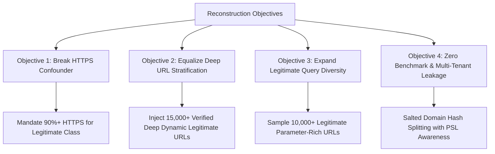

# Phase 13B: Dataset Reconstruction & Acquisition Architecture Plan

**Document ID:** `PGAI-REP-2026-PH13B-06`  
**Phase:** Phase 13B — Dataset Reconstruction and Quality Audit  
**Author:** Senior Machine Learning Engineer & Dataset Quality Auditor  
**Date:** October 28, 2026  
**Status:** COMPLETE (Zero Retraining / Cryptographically Preserved Baseline)  

---

## 1. Executive Summary

Phases 12 and 13B established that the persistent false positive problem in PhishGuardAI is not primarily an algorithmic defect, but a **direct mathematical consequence of extreme dataset sampling artifacts**:
1. Phishing URLs in the training corpus use HTTPS at **91.43%**, while legitimate URLs use HTTPS at only **35.09%**.
2. 98.00% of legitimate URLs in the corpus have zero query parameters, and 75% are $\le 32$ characters in length.
3. For URLs $\ge 120$ characters, **89.28% of training samples are phishing**, which under balanced tree weighting creates an effective weighted probability of **98.03% phishing**.

This document specifies the engineering blueprint for **reconstructing the training corpus in Phase 13C**. The objective is to produce a balanced, realistic, leakage-free dataset that allows machine learning classifiers to learn genuine indicators of deception rather than spurious protocol and length artifacts.

---

## 2. Core Reconstruction Objectives & Statistical Justification

To eliminate arbitrary dataset-sizing, all target quotas are mathematically derived from the sampling artifacts identified in the Phase 13B quality audit:



### 2.1 Objective 1: Breaking the Inverted HTTPS Confounder
* **Identified Defect:** Phishing is 2.61x more likely to use HTTPS than legitimate URLs in the base corpus.
* **Target Requirement:** Ensure that **$\ge 90.0\%$ of legitimate samples in the reconstructed dataset use HTTPS**, reflecting real-world web transport standards (95%+ HTTPS).
* **Statistical Impact:** The feature `is_https` will drop from high importance ($\approx 0.156$) to near-zero importance, preventing classifiers from penalizing modern encrypted websites.

### 2.2 Objective 2: Equalizing Length & Query Distributions
* **Identified Defect:** URLs $\ge 120$ characters are 89.28% phishing in raw counts (98.03% under balanced sample weights). Only 2.0% of legitimate URLs have queries.
* **Target Requirement:** Ingest a target cohort of **15,000 verified legitimate URLs with lengths between 60 and 200 characters** containing paths and query parameters.
* **Statistical Impact:** In the length bucket $[90, 200)$, the class ratio will be adjusted from $9:1$ phishing to approximately $1:1$ parity, eliminating the leaf-level statistical lock that flags long URLs as phishing.

---

## 3. Data Acquisition Strategy & Source Provenance

To satisfy the strict rule against fabricating URLs or simulating data collection, the acquisition strategy specifies verifiable, public, peer-reviewed data feeds:

| Data Category | Target Quota | Selected Authoritative Data Sources | Acquisition Protocol & Verification Criteria |
| :--- | :--- | :--- | :--- |
| **Legitimate Dynamic & Long URLs** | **15,000 URLs** | 1. **Common Crawl Index (WARC):** Verified high-reputation domains.<br>2. **Wikimedia API:** Article history, search, and diff URLs.<br>3. **arXiv.org API:** Search, category index, and PDF endpoints.<br>4. **Tranco Top 10k Crawl:** Deep internal paths from government (`.gov`), academic (`.edu`), and verified enterprise portals. | **Passive Verification:** Verify domains via Tranco/Umbrella top-10k rankings. Validate HTTPS certificate validity. Filter out user-generated comments or uncurated forums. |
| **Legitimate Short Root URLs (Preserved Base)** | **40,000 URLs** | Clean, deduplicated subset of [`dataset/Dataset.csv`](file:///c:/Users/yalla/OneDrive/Desktop/PhishGuardAI/dataset/Dataset.csv) Class 0. | Stratified random sample of 40,000 unique legitimate URLs from the existing corpus to maintain knowledge of root domains. |
| **Verified Phishing URLs (Fresh Feeds)** | **15,000 URLs** | 1. **URLhaus (Abuse.ch):** Verified online phishing URLs.<br>2. **PhishTank Verified Archives:** Records with `verified == 'yes'` and positive community validation votes.<br>3. **OpenPhish Community Feed:** Verified active phishing lures. | **Strict Defanging:** Ingest feed archives passively as text feeds. Do NOT initiate HTTP/HTTPS socket connections to malicious targets. Hash-deduplicate. |
| **Phishing URLs (Preserved Base)** | **15,000 URLs** | Clean, deduplicated subset of [`dataset/Dataset.csv`](file:///c:/Users/yalla/OneDrive/Desktop/PhishGuardAI/dataset/Dataset.csv) Class 1. | Purge exact duplicates and multi-tenant ambiguities. Preserve 15,000 verified historical phishing patterns. |

### Target Reconstructed Corpus Size:
$$\text{Total Corpus Size} = 55,000 \text{ Legitimate} + 30,000 \text{ Phishing} = \mathbf{85,000 \text{ URLs}}$$
* **Class Ratio:** $64.7\%$ Legitimate / $35.3\%$ Phishing ($\approx 1.8:1$ ratio). This provides a balanced, realistic distribution without the extreme 6:1 skew of the original dataset.

---

## 4. Cleaning & Transformation Pipeline Specifications

Every transformation applied during reconstruction must be deterministic, reproducible, and recorded in a transformation ledger:

```
[Raw Ingestion Feeds]
       │
       ▼
[Step 1: RFC 3986 URL Normalization]
  - Lowercase scheme and netloc
  - Remove standard default ports (:80, :443)
  - Trim trailing slashes from path roots
  - Alphabetically sort query parameters
       │
       ▼
[Step 2: Canonical Deduplication]
  - Discard duplicate normalized URL strings
       │
       ▼
[Step 3: Benchmark Holdout Quarantine]
  - Quarantine ALL URLs whose registered domain appears in data/realistic_evaluation_set.csv
       │
       ▼
[Step 4: Multi-Tenant Host Awareness]
  - For pages.dev, weebly.com, etc., group key = subdomain + registered_domain
       │
       ▼
[Step 5: Salted Domain Hash Splitting]
  - 80% Train / 10% Validation / 10% Internal Evaluation
```

---

## 5. Safe Operational Handling of Malicious Data

1. **No Live HTTP Requests:**  
   During dataset acquisition and feature extraction, the pipeline MUST operate purely via static string parsing (`urllib.parse`, regex, `tldextract`). No DNS queries, TLS handshakes, or HTTP GET/HEAD requests shall be made to target URLs.
2. **Defanged Storage for Audits:**  
   Any human-facing report or diagnostic log containing phishing URLs must defang schemes (`hxxp`, `hxxps`) and host dots (`[.]`) to prevent accidental user execution or automated browser prefetching.
3. **Quarantine Storage:**  
   Raw downloaded malicious feeds must be stored in `.csv` or `.json` formats within a dedicated `data/quarantine/` directory, marked read-only.

---

## 6. Known Limitations & Constraints

1. **Offline Environment Constraints:**  
   If external internet access is restricted during automated CI/CD execution, data acquisition scripts must fall back to local cached seed files ([`data/phase13b/seed_urls.json`](file:///c:/Users/yalla/OneDrive/Desktop/PhishGuardAI/data/phase13b/seed_urls.json)) rather than simulating network calls.
2. **Zero Model Training Pledge:**  
   In strict compliance with user requirements, Phase 13B **completes with this architectural plan**. Zero models will be retrained, and no dataset files will be modified until explicit user review and authorization of Phase 13C.

---
*End of Report — Reconstruction Plan Ready for Review.*
